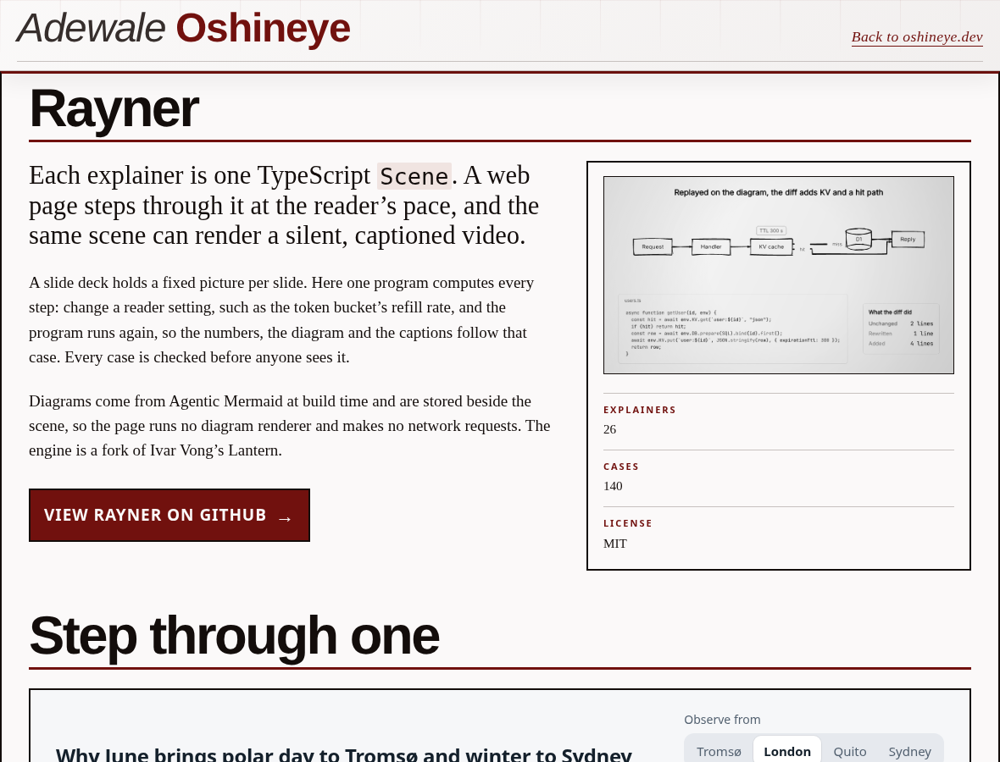
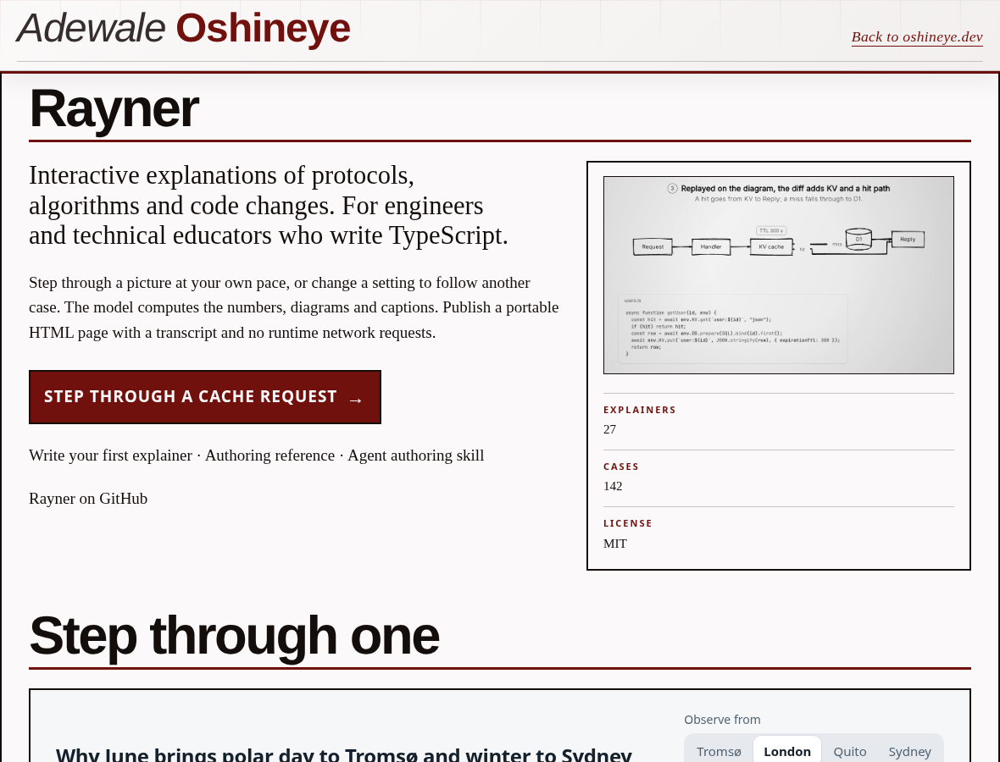
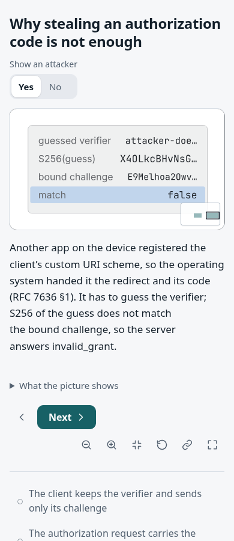
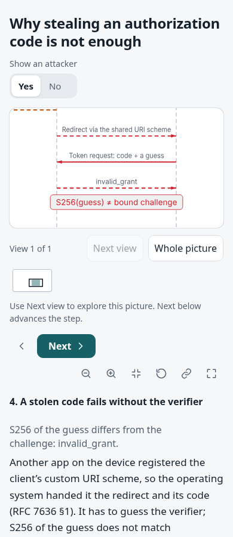

# Rayner gallery and reader refresh

Hosting baseline: `8824d5895c1c0b9e42a3cee8271a45690243a8dd`. Rayner source and authoring fixes: `aa654e901d5658bc54e1c9537fdfd025e3f120da` in the companion Rayner PR.

The old page advertised video and Node 26, listed 26 explainers / 140 cases, and maintained its own titles and copy. The new page reads `site/projects/rayner/catalog.json`, exported from Rayner. It explains the audience and purpose first, links a working cache request and the authoring guides, and shows 27 explainers / 142 cases. `bun run build` regenerates the branded page and both clean-URL spellings. A regression test rejects contradictory counts and verifies repeated generation is unchanged.

The exported reader pages include the already-merged phone/story fixes: the OAuth attack opens on its three arrows, labels have clear route plates, and reader values are no longer abbreviated. The 27 individual HTML pages are byte-identical to the reviewed Rayner release export. The new pen-and-pencil page is included. Step share pages and their pictures are exported too.

`site/_headers` replaces the old page policies. It also makes the loader revalidate instead of inheriting a year-long immutable cache. Local Wrangler parsed 57 header rules; a real HTTP request confirmed the loader's `Cache-Control: public, max-age=0, must-revalidate`.

## Before and after

Same viewports: gallery at 1180 × 900 and 390 × 900; OAuth `attacker=yes&step=attack` at 390 × 900. Before images were captured from fresh public responses during the audit; the gallery response is exactly the hosting baseline's HTML bytes. After images use local Wrangler Workers Static Assets. Both use fallback fonts because Typekit is unavailable in the environment.

| Before | After | Inspect |
| --- | --- | --- |
|  |  | Purpose, audience, working example, authoring links and counts. |
|  |  | All three arrows and their labels fit the opening. |

[Phone gallery before](gallery-before-390.png) · [Phone gallery after](gallery-after-390.png).

## Verification

- `bun run typecheck`, `bun run test`: passed; 17 tests, zero failures.
- `bun run build`: regenerates the catalog page and builds the existing site assets.
- Rayner export: 208 pages passed link-preview checks.
- Served-reader review through local Wrangler: 10 cases and 106 step/width states passed, covering OAuth, KV cache, Lantern, token bucket and pen-and-pencil. [Receipt](reader-review.json).
- All 449 files listed by the deployment manifest match their SHA-256. The host generator updates the landing-page entries and records its own hash after applying the branded template.
- The deployment workflow retains preview as its default and adds an explicit production selection, with type checking and tests before deploy. Production uses the existing Cloudflare secret; this PR does not contain credentials.

The screenshots do not establish model truth, every viewport, subject-expert review, screen-reader compliance or a live production deployment. The reader receipt is from local Workers Static Assets. After deploying, compare the actual public responses with `deployment.json` and check the phone opening again.

To update later:

```sh
# In Rayner, after building and reviewing its collection:
npm run site:export -- /path/to/oshineye-dev/site --origin https://oshineye.dev
# In this repository:
bun run build
```

Product copy is derived from Rayner's README and exported product metadata. Counts, titles and groups come from the exported catalog; they are not independently edited here.
